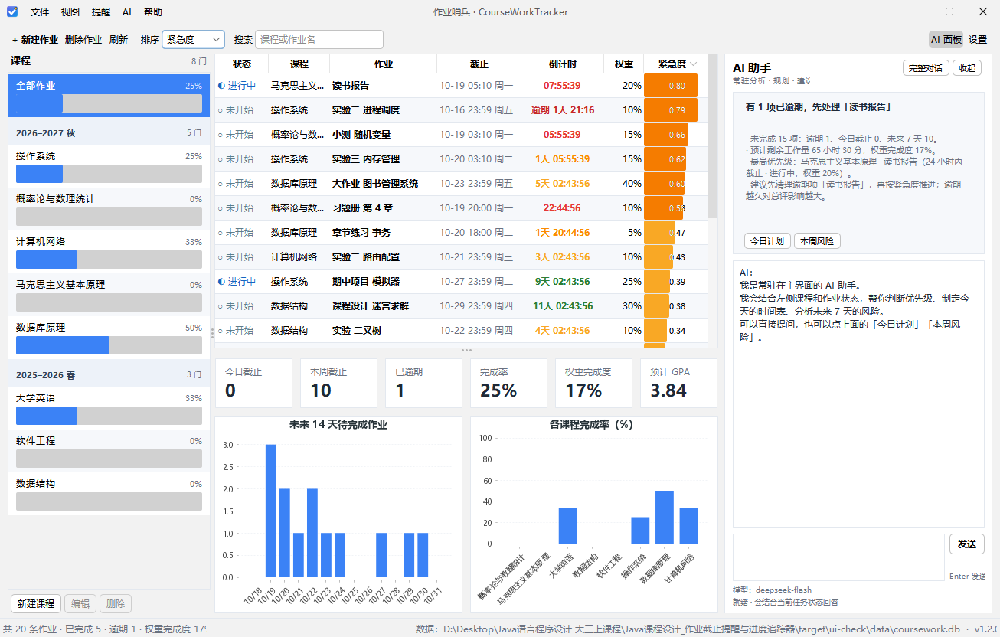
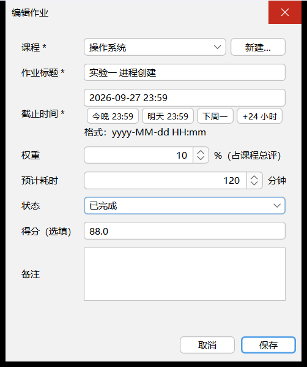

# 作业哨兵 · CourseWorkTracker

[](https://github.com/suxiangyu138/coursework-tracker/actions/workflows/ci.yml)
[](https://github.com/suxiangyu138/coursework-tracker)
[](https://gitee.com/suxiangyu138/coursework-tracker)
[](https://openjdk.org/projects/jdk/17/)
[](LICENSE)

> 一学期十几门课，作业截止日散落在雨课堂、学习通、班级群和老师的口头通知里。
> 作业哨兵把它们收进一个常驻桌面的小工具：**还剩几天、先做哪个、做完多少、期末要考多少分**。

---

## 项目信息

| 项目 | 内容 |
| --- | --- |
| 课程 | Java 语言程序设计（2026 秋 · 大三上） |
| 类型 | 期末课程设计（个人项目） |
| 作者 | 苏巷雨（学号：待填） |
| 技术栈 | Java 17 · Swing + FlatLaf · SQLite（JDBC）· JFreeChart · Maven |
| 运行环境 | Windows 10/11 优先，Linux / macOS 可运行；JDK 17 及以上 |
| 当前状态 | `v1.0.0` 功能实现完成，68 条自动化测试通过，`--selftest` 自检通过 |

---

## 远程仓库

| 平台 | 地址 | 说明 |
| --- | --- | --- |
| GitHub（主） | <https://github.com/suxiangyu138/coursework-tracker> | 主仓库，GitHub Actions 自动跑测试 |
| Gitee（镜像） | <https://gitee.com/suxiangyu138/coursework-tracker> | 国内访问更快 |

```bash
git clone https://github.com/suxiangyu138/coursework-tracker.git
# 或
git clone https://gitee.com/suxiangyu138/coursework-tracker.git
```

本地同时配置了两个远端：`origin`（GitHub）与 `gitee`（Gitee），推送时分别执行 `git push origin main`、`git push gitee main`。

---

## 它解决什么问题

1. **截止日四处散落**：雨课堂一个、学习通一个、班级群一个、老师课上口头一个，临交才发现。
2. **不知道该先做哪个**：三个作业都"快到期"，但权重 5% 的读书报告和权重 40% 的大作业，优先级显然不同。
3. **不知道自己做到哪了**：一门课十几次作业，做到第几次、还剩多少工作量，全凭记忆。
4. **不知道期末要考多少分**：平时分已经拿了多少、期末考多少才能到 90，没人替你算。

作业哨兵把「倒计时 + 紧急度排序 + 完成度统计 + 成绩预估」四件事串成一个闭环，常驻托盘，不占任务栏。

---

## 功能一览

### P0 · 核心功能（本次课程设计必须交付）

| 模块 | 功能 | 说明 |
| --- | --- | --- |
| 作业管理 | 录入 / 编辑 / 删除作业 | 课程、标题、截止时间、权重(%)、预计耗时、备注 |
| | 状态流转 | 未开始 → 进行中 → 已完成 / 已提交 |
| | 筛选与搜索 | 按课程、状态、关键词过滤 |
| 倒计时 | 实时倒计时 | 秒级刷新，显示「3天 04:12:05」/「已逾期 2 天」 |
| | 颜色语义 | 红（<24h）/ 橙（<72h）/ 黄（<7d）/ 绿 / 灰（已完成） |
| | 紧急度排序 | 综合剩余时间、权重、预计耗时计算，可切换按截止时间 / 权重 / 紧急度排序 |
| 提醒 | 分级提醒 | T-24h、T-6h、T-1h、T-15min 四档 |
| | 逾期提醒 | 逾期未交每天汇总提醒一次 |
| | 托盘常驻 | 最小化到托盘、气泡通知、托盘菜单 |
| 统计 | 完成度 | 总体完成率、按课程完成率、**权重完成度**（已完成作业占总权重比） |
| | 工作量图表 | 未来 14 天到期数量柱状图 + 各课程完成率条形图 |
| 成绩 | 加权得分 | 按作业权重计算课程当前得分 |
| | 总评预估 | 未出分部分按已完成均分预测，得出预计总评 |
| 系统 | 本地持久化 | SQLite 单文件，自动建库、事务写入 |
| | 单实例运行 | 重复启动不产生两个托盘图标 |

### P1 · 增强功能

- ✅ 目标分反推：`期末考多少能拿 90`，不可达时明确提示
- ✅ GPA 预估：加权绩点，标准 4.0 映射
- ✅ 静音时段（默认 23:00–07:00 不弹窗，恢复后合并播报）
- ✅ 错过提醒补偿：程序未运行期间错过的提醒，启动后补发一次
- ✅ 课程管理（学分、教师、目标分）
- ✅ 深色主题（设置中切换，即时生效）
- ⬜ 数据导出 / 导入（当前可复制 `data/coursework.db` 备份，JSON 导入待做）
- ✅ 开机自启（Windows 注册表启动项，设置内可开关，默认关闭）

### P2 · 扩展（不做，仅记录）

- 月历视图、多学期归档、云同步、教务系统导入、移动端。

---

## 界面





界面特点：

- 左侧课程列表带完成率进度条，点击即筛选；
- 表格按紧急度排序，倒计时按紧迫度着色，逾期显示深红；
- 底部 6 个指标卡（今日/本周/逾期/完成率/权重完成度/预计 GPA）+ 两张图表；
- 关闭窗口最小化到托盘，提醒以气泡弹出。

---

## 快速开始

### 环境要求

| 依赖 | 版本 |
| --- | --- |
| JDK | 17 及以上（开发机 JDK 25 已验证编译 `--release 17`） |
| Maven | 3.8 及以上（开发机 3.9.16） |

### 构建与运行

```bash
# 1. 编译 + 测试 + 打包（含依赖的 fat jar）
mvn clean package

# 2. 运行
java -jar target/coursework-tracker-1.0.0.jar

# 3. 其他入口
java -jar target/coursework-tracker-1.0.0.jar --seed-demo   # 仅生成示例数据（8 门课 / 20 条作业）
java -jar target/coursework-tracker-1.0.0.jar --selftest    # 无界面自检：建库、算成绩、跑提醒
java -jar target/coursework-tracker-1.0.0.jar --screenshot=docs/assets/main-light.png  # 渲染界面截图
java -jar target/coursework-tracker-1.0.0.jar --minimized    # 启动后直接进托盘，不弹窗口
java -jar target/coursework-tracker-1.0.0.jar --autostart=on # 开启开机自启（off / status 同理）
```

首次启动若数据库为空，程序会询问是否生成示例数据；也可以在「文件 → 生成示例数据」中随时生成。

### 数据文件

| 路径 | 说明 |
| --- | --- |
| `data/coursework.db` | SQLite 数据库，首次启动自动创建（与 jar 同级） |
| `logs/app.log` | 运行日志，单文件上限 5 MB |

删除 `data/` 目录即恢复出厂状态；备份数据只需复制 `coursework.db`。


---

## 开机自启与资源占用

### 实测占用

Windows 11 / JDK 25 / 20 条示例作业、窗口静止：

| 启动配置 | 物理内存 | 私有内存 | 线程数 | 空闲 CPU |
| --- | --- | --- | --- | --- |
| 默认 JVM | 182 MB | 226 MB | 40 | ~0% |
| `-Xms32m -Xmx256m -XX:+UseSerialGC` | **135–140 MB** | **118–124 MB** | **27** | ~0% |
| 调优参数 + `--minimized`（仅托盘） | **107 MB**（启动 10 秒时） | 104 MB | 28 | ~0% |

- JVM 堆实际只用了约 20–45 MB；默认的 4 GB 是虚拟地址上限，不是真实占用
- 启动到可交互约 1 秒；每秒刷新倒计时只做时间计算，不查数据库
- 优化后约占 16 GB 机器的 0.9%，8 GB 机器约 1.7%

### 开启 / 关闭

在「设置 → 开机自启（登录后最小化到托盘）」勾选保存即可，不需要管理员权限（写入 `HKCU`）。

也可以用命令行：

```bash
java -jar target/coursework-tracker-1.0.0.jar --autostart=on
java -jar target/coursework-tracker-1.0.0.jar --autostart=status
java -jar target/coursework-tracker-1.0.0.jar --autostart=off
```

写入的启动命令：

```text
javaw -Xms32m -Xmx256m -XX:+UseSerialGC -jar <项目路径>\target\coursework-tracker-1.0.0.jar --minimized
```

### 手动启动

- `scripts/start.bat`：用 `javaw` + 低内存参数启动，无控制台窗口
- `--minimized`：只进托盘，不弹主窗口，提醒仍然生效

### 注意

- 仅 Windows 支持，且需以打包后的 jar 运行；开发模式（`target/classes`）下开关自动禁用
- 若担心拖慢登录，可改用任务计划程序设置 30 秒延迟，而不是直接写 Run 键
- 关闭自启后会自动删除注册表项，可在 `--autostart=status` 中确认

---

## 技术亮点（对应课程知识点）

| 课程知识点 | 在本项目中的落地 |
| --- | --- |
| `java.time` 时间处理 | `LocalDateTime` / `Duration` / `DateTimeFormatter` 实现倒计时、逾期判定、时间格式化；时间源通过 `Clock` 注入，便于测试 |
| 多线程与定时器 | `ScheduledExecutorService` 周期扫描提醒 + `javax.swing.Timer` 秒级刷新界面，Swing 单线程模型与后台线程通过 `SwingUtilities.invokeLater` 安全交接 |
| 集合与排序 | `Comparator` 多级排序（紧急度 → 截止 → 权重 → id）、`TableRowSorter` 表头排序、`Record` 不可变数据 |
| 面向对象设计 | 三层架构（UI / Service / DAO）、接口与实现分离、枚举状态机、不可变值对象（`record`） |
| JDBC 数据库编程 | SQLite 连接管理、PreparedStatement 防注入、事务、索引、外键级联、建表脚本与版本迁移 |
| 图形界面 | Swing 自定义 `JTable` 渲染器（紧急度进度条、倒计时着色）、`ListCellRenderer`（课程进度条）、FlatLaf 主题 |
| 图表绘制 | JFreeChart 柱状图封装为可复用面板，跟随浅色/深色主题 |
| 文件与 IO | 单实例文件锁、日志文件、SQLite 数据文件备份 |
| 测试 | JUnit 5：68 条自动化测试（含 12 条 DAO 集成测试），`@TempDir`/内存库隔离 |

---

## 目录结构

```text
Java课程设计_作业截止提醒与进度追踪器/
├── pom.xml
├── README.md / CHANGELOG.md / LICENSE
├── CONTRIBUTING.md / CODE_OF_CONDUCT.md / SECURITY.md
├── .github/                    # CI 流水线、Issue 与 PR 模板
├── .gitignore / .gitattributes / .editorconfig
├── docs/                       # 需求、方案、计划、测试、交付说明、截图
├── scripts/start.bat           # javaw + 低内存参数启动
├── src/main/java/com/coursework/tracker/
│   ├── App.java                # 入口：单实例、外观、托盘、主窗口、CLI 参数
│   ├── SelfTest.java           # 无界面自检
│   ├── core/                   # AppContext、AppPaths、AutoStartManager、ClockProvider、EventBus、单实例锁、日志
│   ├── model/                  # Assignment、Course、Countdown、Urgency、ReminderRule、CourseGrade …
│   ├── dao/                    # Database、SchemaMigrator、CourseDao、AssignmentDao、ReminderLogDao、SettingDao
│   ├── service/                # 作业/课程服务、提醒规划与调度、统计、成绩、设置、示例数据
│   ├── ui/                     # MainFrame、TrayController、ThemeManager、panel/、dialog/、table/
│   └── util/                   # TimeUtils、Formatters、UrgencyCalculator、GradeCalculator
├── src/main/resources/db/schema.sql
└── src/test/java/…             # 6 个测试类，68 条测试
```

---

## 文档索引

> 完整文档地图、推荐阅读顺序与维护约定见 **[docs/README.md](docs/README.md)**。

| 文档 | 内容 | 适合谁看 |
| --- | --- | --- |
| [01-需求分析](docs/01-需求分析.md) | 背景、用户故事、功能与非功能需求、业务规则、边界场景 | 验收人 / 评阅老师 |
| [02-技术方案](docs/02-技术方案.md) | 技术选型、分层架构、数据模型与 DDL、核心算法公式、线程模型、UI 设计 | 开发 / 答辩 |
| [03-开发计划](docs/03-开发计划.md) | 里程碑、WBS 任务分解、提交规范、交付物清单 | 自己排期 |
| [04-测试与验收](docs/04-测试与验收.md) | 测试策略、用例表、边界场景、验收标准、演示脚本 | 自测 / 答辩 |
| [05-课程设计交付说明](docs/05-课程设计交付说明.md) | 作业要求对照、技术点实现映射、亮点、答辩提纲 | 交作业 / 答辩 |

---

## 开发进度

- [x] **M0 需求与方案**：文件夹命名、Git 仓库、需求分析、技术方案、开发计划、测试方案
- [x] **M1 数据层**：`pom.xml`、模型、SQLite 建表、DAO、单元测试
- [x] **M2 主界面**：主窗口、作业表格、新建/编辑对话框、课程筛选
- [x] **M3 倒计时与排序**：秒级刷新、颜色语义、紧急度算法、多维度排序
- [x] **M4 提醒与托盘**：调度器、分级提醒、去重、托盘常驻、单实例
- [x] **M5 统计与图表**：完成度卡片、JFreeChart 图表、按课程统计
- [x] **M6 成绩预估**：加权得分、总评预估、目标分反推、GPA
- [x] **M7 打磨交付**：主题、异常兜底、README 截图、打包、自检

---

## 仓库规范

| 文件 | 说明 |
| --- | --- |
| [LICENSE](LICENSE) | MIT 许可证 |
| [CONTRIBUTING.md](CONTRIBUTING.md) | 环境准备、分支与提交规范、测试要求、PR 流程 |
| [CODE_OF_CONDUCT.md](CODE_OF_CONDUCT.md) | 行为准则 |
| [SECURITY.md](SECURITY.md) | 安全策略与漏洞报告方式 |
| [.github/ISSUE_TEMPLATE](.github/ISSUE_TEMPLATE) | Bug / 功能建议模板 |
| [.github/PULL_REQUEST_TEMPLATE.md](.github/PULL_REQUEST_TEMPLATE.md) | PR 自查清单 |
| [.github/workflows/ci.yml](.github/workflows/ci.yml) | GitHub Actions：测试 → 打包 → 自检 → 上传产物 |

## 参与贡献

- 提交代码前请阅读 [CONTRIBUTING.md](CONTRIBUTING.md)
- Bug 与功能建议请使用 Issue 模板，Gitee 镜像也可提交
- 功能改动请同步更新 `CHANGELOG.md` 与相关文档
- 参与本项目即表示同意 [行为准则](CODE_OF_CONDUCT.md)

如果这个项目对你有帮助，欢迎点一个 ⭐ Star 支持一下。

---

## 常见问题

| 问题 | 处理 |
| --- | --- |
| 双击 jar 没反应 | 用 `java -jar` 启动，或检查是否安装了 JDK 17+；日志见 `logs/app.log` |
| 中文显示为方块 | 打包时未携带字体或系统缺少中文字体；本项目使用系统字体，正常不会出现 |
| 提醒不弹窗 | Windows「通知和操作」中允许 Java 应用通知；程序内「设置 → 提醒开关」是否开启 |
| 想清空数据 | 关闭程序，删除 `data/coursework.db` |
| 换电脑 | 复制整个 `data/` 目录到新机器的相同位置 |

---

## 许可证

本项目基于 [MIT License](LICENSE) 开源，Copyright (c) 2026 苏巷雨。

你可以自由使用、修改、分发本项目，只需保留版权声明与许可声明。本项目最初为 Java 语言程序设计课程作业，欢迎用于学习与二次开发。
