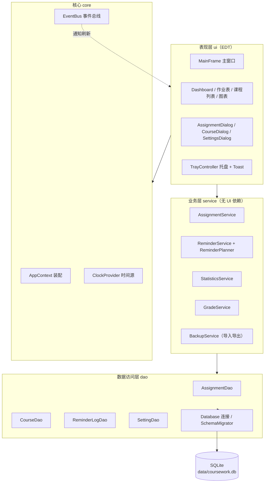
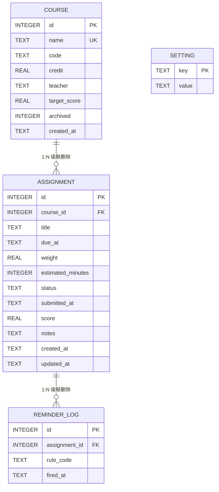
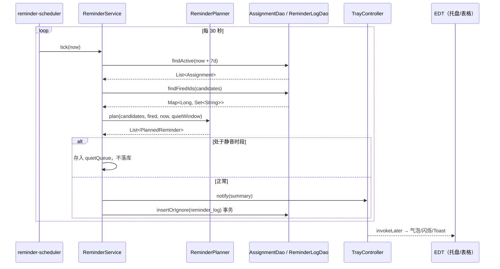

# 02 · 技术方案

| 项目 | 内容 |
| --- | --- |
| 文档版本 | v1.0 |
| 更新日期 | 2026-10-18 |
| 对应代码版本 | v0.1.0（设计阶段） |
| 关联文档 | [01-需求分析](01-需求分析.md) · [03-开发计划](03-开发计划.md) |

---

## 1. 方案总览

### 1.1 一句话架构

> **Swing 单窗口 + 本地 SQLite + 后台调度线程 + 托盘常驻**，用分层结构把「数据、规则、界面」拆开：
> UI 只负责显示与交互，Service 承载全部业务规则（排序 / 提醒 / 统计 / 成绩），DAO 负责 SQL，模型层是不可变数据。

### 1.2 设计原则

| 原则 | 落地方式 |
| --- | --- |
| 纯函数算业务 | 紧急度、成绩、时间格式化全部为无状态静态方法，可直接单元测试 |
| 时间可注入 | 所有"现在"来自 `ClockProvider`，测试用 `Clock.fixed(...)`，杜绝 `LocalDateTime.now()` 散落 |
| 单线程碰 UI | 所有 Swing 操作在 EDT；后台线程只算数据，通过 `invokeLater` 回传 |
| 数据库小而稳 | 单连接 + 事务 + WAL，写入路径短；读多写少 |
| 失败要可见 | 未捕获异常统一捕获写日志 + 弹窗，不静默吞异常 |
| 可解释 | 紧急度显示分数与构成，成绩预估显示公式与假设，用户能理解"为什么" |

---

## 2. 技术选型

### 2.1 选型对比

| 维度 | 选项 A（采用） | 选项 B | 选项 C | 结论与理由 |
| --- | --- | --- | --- | --- |
| 界面 | **Swing + FlatLaf** | JavaFX | 命令行 / Web | Swing 零模块配置、单 jar 可跑、`SystemTray` 原生支持；JavaFX 需要模块路径与额外打包步骤，课程演示环境风险高；命令行不满足"桌面常驻小工具" |
| 持久化 | **SQLite（sqlite-jdbc）** | JSON 文件 | H2 内嵌 | SQLite 单文件、可用 Navicat/DBeaver 直接查看、SQL 能力完整、体积小；JSON 并发与查询能力弱；H2 纯 Java 更稳但文件格式不通用。SQLite 作为首选，H2 为兜底（见 §13 风险 R-01） |
| 图表 | **JFreeChart** | 自绘 Graphics2D | JavaFX Charts | JFreeChart 成熟、API 简单、与 Swing 集成好；自绘工作量大且不美观；JavaFX Charts 依赖 JavaFX 栈 |
| 定时 | **ScheduledExecutorService** | java.util.Timer | 虚拟线程 + 轮询 | `Timer` 单线程且任务异常会杀死整个定时器；`ScheduledExecutorService` 支持守护线程、异常隔离、固定延迟语义，是标准做法 |
| 界面刷新 | **javax.swing.Timer（1s）** | 后台线程直接改 UI | 每秒查库 | Swing Timer 在 EDT 执行，天然线程安全；每秒查库会造成无谓 IO，改为内存快照 |
| 构建 | **Maven + Shade** | Gradle | 手工 javac | Maven 课程通用、依赖管理清晰，Shade 产出可双击运行的 fat jar |
| 日志 | **java.util.logging（JUL）** | SLF4J + Logback | 自写 | JUL 零依赖，配合 `logging.properties` 足够；减少依赖降低打包风险 |
| JSON | **Gson 2.11** | Jackson | 手写 | 备份导出/导入需要结构化 JSON，Gson 轻量、对 record 支持好 |
| 测试 | **JUnit 5** | JUnit 4 | 无 | Jupiter 支持参数化测试与嵌套，适合算法用例 |

### 2.2 版本基线

| 组件 | 版本 | 说明 |
| --- | --- | --- |
| JDK | 17（编译目标） | 开发机 JDK 25 以 `--release 17` 编译，兼顾课程环境 |
| Maven | 3.9.x | 开发机 3.9.16 |
| FlatLaf | 3.5.4 | 现代外观，支持浅色/深色 |
| JFreeChart | 1.5.6 | 柱状图、环形图 |
| sqlite-jdbc | 3.46.1.3 | 内含各平台原生库 |
| JUnit Jupiter | 5.11.0 | 单元测试 |
| JaCoCo | 0.8.12 | 覆盖率 |

> 版本以 `pom.xml` 锁定为准；上表为已验证可用的组合，避免使用最新未验证版本。

---

## 3. 总体架构

### 3.1 分层



**依赖方向**：`ui → service → dao → db`，反向只允许事件（`EventBus`）与模型对象。Service 层不出现任何 `javax.swing` 类型，保证算法可测。

### 3.2 各层职责

| 层 | 职责 | 不允许做的事 |
| --- | --- | --- |
| `ui` | 渲染、输入校验、交互反馈、把 DTO 转成显示文本 | 写 SQL、算业务分数 |
| `service` | 事务边界、业务规则、算法编排、事件发布 | 弹窗、直接操作 Swing 组件 |
| `dao` | SQL、ResultSet ↔ 模型映射、批量查询 | 业务判断（如"是否逾期"） |
| `model` | 不可变数据结构、值对象、枚举 | 依赖任何上层 |
| `core` | 装配、配置、时间、事件、单实例、路径 | 业务逻辑 |

### 3.3 包结构

```text
com.coursework.tracker
├── App.java                    启动：外观 → 单实例 → 数据库 → 托盘 → 主窗口
├── core/
│   ├── AppContext.java         手写依赖装配（Service/DAO 单例持有）
│   ├── AppPaths.java           data/、logs/ 路径解析（jar 同级目录）
│   ├── ClockProvider.java      Clock 持有与替换（测试注入）
│   ├── EventBus.java           类型化发布订阅
│   ├── AppEvents.java          事件定义（AssignmentChanged / DataReloaded …）
│   └── SingleInstanceGuard.java FileLock 单实例
├── model/
│   ├── Course.java             record(id, name, code, credit, teacher, targetScore, archived)
│   ├── Assignment.java         record(id, courseId, title, dueAt, weight, estimatedMinutes,
│   │                                   status, submittedAt, score, notes, createdAt, updatedAt)
│   ├── AssignmentStatus.java   枚举：TODO / DOING / DONE / SUBMITTED（含中文显示名、是否完成）
│   ├── Urgency.java            record(score, timePressure, weightPressure, effortPressure)
│   ├── ReminderRule.java       record(code, offset)
│   ├── ReminderLog.java        record(assignmentId, ruleCode, firedAt)
│   ├── GradeScale.java         绩点映射接口 + Standard4Scale 实现
│   ├── CourseGrade.java        课程成绩视图（得分、权重、预测、所需分）
│   ├── CompletionStats.java    完成度统计 DTO
│   └── TimeBucket.java         按天聚合的工作量
├── dao/
│   ├── Database.java           连接、PRAGMA、事务模板
│   ├── SchemaMigrator.java     建表与版本迁移
│   ├── CourseDao.java
│   ├── AssignmentDao.java
│   ├── ReminderLogDao.java
│   └── SettingDao.java
├── service/
│   ├── CourseService.java
│   ├── AssignmentService.java  增删改查 + 状态流转 + 事件发布
│   ├── ReminderPlanner.java    纯函数：给定作业、规则、已触发集合 → 应触发列表
│   ├── ReminderService.java    调度线程、扫描、去重、静音、合并播报
│   ├── StatisticsService.java  完成度、工作量聚合
│   ├── GradeService.java       加权得分、总评预估、目标反推、GPA
│   └── BackupService.java      JSON 导入导出（P1）
├── ui/
│   ├── MainFrame.java
│   ├── AppMenuBar.java
│   ├── panel/
│   │   ├── AssignmentTablePanel.java
│   │   ├── CourseListPanel.java
│   │   ├── DashboardPanel.java
│   │   └── ChartPanelFactory.java
│   ├── dialog/
│   │   ├── AssignmentDialog.java
│   │   ├── CourseDialog.java
│   │   ├── SettingsDialog.java
│   │   └── GradeDetailDialog.java
│   ├── table/
│   │   ├── AssignmentTableModel.java
│   │   ├── CountdownRenderer.java
│   │   ├── StatusRenderer.java
│   │   ├── UrgencyRenderer.java
│   │   └── DueDateRenderer.java
│   ├── TrayController.java
│   ├── Toast.java              自绘轻量提示（不阻塞）
│   └── ThemeManager.java       FlatLaf 明暗切换
└── util/
    ├── TimeUtils.java          倒计时格式化、逾期判定、日边界
    ├── Formatters.java         日期、权重、分数格式化
    ├── UrgencyCalculator.java  紧急度算法
    ├── GradeCalculator.java    成绩算法（纯函数）
    └── CsvUtils.java           CSV 读写（P1）
```

---

## 4. 数据模型

### 4.1 ER 图



### 4.2 建表 SQL（`src/main/resources/db/schema.sql`）

```sql
PRAGMA foreign_keys = ON;

CREATE TABLE IF NOT EXISTS course (
    id           INTEGER PRIMARY KEY AUTOINCREMENT,
    name         TEXT    NOT NULL UNIQUE,
    code         TEXT,
    credit       REAL    NOT NULL DEFAULT 0 CHECK (credit >= 0 AND credit <= 20),
    teacher      TEXT,
    target_score REAL             CHECK (target_score IS NULL OR (target_score > 0 AND target_score <= 100)),
    archived     INTEGER NOT NULL DEFAULT 0 CHECK (archived IN (0, 1)),
    created_at   TEXT    NOT NULL
);

CREATE TABLE IF NOT EXISTS assignment (
    id                INTEGER PRIMARY KEY AUTOINCREMENT,
    course_id         INTEGER NOT NULL REFERENCES course(id) ON DELETE CASCADE,
    title             TEXT    NOT NULL,
    due_at            TEXT    NOT NULL,
    weight            REAL    NOT NULL DEFAULT 0 CHECK (weight >= 0 AND weight <= 100),
    estimated_minutes INTEGER          CHECK (estimated_minutes IS NULL OR estimated_minutes >= 0),
    status            TEXT    NOT NULL DEFAULT 'TODO'
                              CHECK (status IN ('TODO', 'DOING', 'DONE', 'SUBMITTED')),
    submitted_at      TEXT,
    score             REAL             CHECK (score IS NULL OR (score >= 0 AND score <= 100)),
    notes             TEXT,
    created_at        TEXT    NOT NULL,
    updated_at        TEXT    NOT NULL
);

CREATE TABLE IF NOT EXISTS reminder_log (
    id            INTEGER PRIMARY KEY AUTOINCREMENT,
    assignment_id INTEGER NOT NULL REFERENCES assignment(id) ON DELETE CASCADE,
    rule_code     TEXT    NOT NULL,
    fired_date    TEXT    NOT NULL,          -- yyyy-MM-dd，逾期提醒按天去重
    fired_at      TEXT    NOT NULL,
    UNIQUE (assignment_id, rule_code, fired_date)
);

CREATE TABLE IF NOT EXISTS setting (
    key   TEXT PRIMARY KEY,
    value TEXT NOT NULL
);

CREATE TABLE IF NOT EXISTS ai_conversation (
    id         INTEGER PRIMARY KEY AUTOINCREMENT,
    title      TEXT NOT NULL,
    created_at TEXT NOT NULL,
    updated_at TEXT NOT NULL
);

CREATE TABLE IF NOT EXISTS ai_message (
    id              INTEGER PRIMARY KEY AUTOINCREMENT,
    conversation_id INTEGER NOT NULL REFERENCES ai_conversation(id) ON DELETE CASCADE,
    role            TEXT    NOT NULL CHECK (role IN ('user', 'assistant', 'tool')),
    content         TEXT,
    tool_calls      TEXT,          -- assistant 的工具调用 JSON
    tool_call_id    TEXT,          -- tool 消息关联的调用 id
    created_at      TEXT    NOT NULL
);

CREATE INDEX IF NOT EXISTS idx_assignment_due    ON assignment(due_at);
CREATE INDEX IF NOT EXISTS idx_assignment_course ON assignment(course_id);
CREATE INDEX IF NOT EXISTS idx_assignment_status ON assignment(status);
CREATE INDEX IF NOT EXISTS idx_reminder_fired    ON reminder_log(fired_at);
CREATE INDEX IF NOT EXISTS idx_ai_message_conv   ON ai_message(conversation_id, id);
```

### 4.3 字段与时间约定

| 约定 | 说明 |
| --- | --- |
| 主键 | `INTEGER PRIMARY KEY AUTOINCREMENT`（SQLite 行 id 别名） |
| 时间存储 | 文本，格式 `yyyy-MM-dd HH:mm:ss`，本地时区语义；字典序即时间序，可直接 `BETWEEN` 比较 |
| 布尔 | 用 `INTEGER 0/1`（SQLite 无布尔类型） |
| 金额/权重 | 用 `REAL`，界面保留 1 位小数，计算用 `BigDecimal` 规避浮点误差（见 §6.5） |
| 逻辑删除 | 不做，直接物理删除 + 级联 |
| 归档 | `course.archived = 1`，统计与提醒自动排除 |

> **为什么不用 `LocalDateTime` 存 epoch？** 课程截止日本质是"本地墙钟时间"（老师说的"周五 23:59"就是本地时间），存本地字符串可读、可直接用 DB 工具查、不受时区变更影响；跨时区场景不在范围内。

### 4.4 版本迁移

`setting` 表存 `schema_version`，当前为 **v3**。`SchemaMigrator` 按版本执行迁移：

```java
// v1：初始建表
// v2：reminder_log 增加 fired_date，唯一约束改为 (assignment_id, rule_code, fired_date)
//     使"逾期每日提醒"成立，普通档位仍然只提醒一次
// v3：新增 ai_conversation / ai_message（AI 对话与消息）
```

v2 迁移采用"重建表"方式（SQLite 修改唯一约束需要重建）：

```sql
CREATE TABLE reminder_log_v2 (... fired_date TEXT NOT NULL,
    UNIQUE (assignment_id, rule_code, fired_date));
INSERT INTO reminder_log_v2(id, assignment_id, rule_code, fired_date, fired_at)
    SELECT id, assignment_id, rule_code, substr(fired_at, 1, 10), fired_at FROM reminder_log;
DROP TABLE reminder_log;
ALTER TABLE reminder_log_v2 RENAME TO reminder_log;
CREATE INDEX idx_reminder_fired ON reminder_log(fired_at);
```

启动流程：读取 `schema_version` → 新库直接建最新结构 → 老库依次执行大于当前版本的迁移 → 更新版本号，全部在单事务中完成。迁移失败回滚并记录日志。

---

## 5. 核心算法

### 5.1 紧急度评分（排序核心）

对单条**未完成**作业计算 `urgency`：

```text
输入：now、dueAt、weight(0–100)、estimatedMinutes(可空)、status
H = 168 小时（视野窗口，可配置 24–720）

r = Duration.between(now, dueAt).toMinutes() / 60.0        // 剩余小时，可为负

timeP   = r >= 0 ? clamp(1 - r / H, 0, 1)
                  : 1 + min(7, ceil(-r / 24.0)) * 0.1      // 逾期 1.1 ~ 1.7
weightP = clamp(weight / 40.0, 0, 1)                        // 40% 权重视为满压力
effortP = clamp((estimatedMinutes == null ? 60 : estimatedMinutes) / 480.0, 0, 1)

urgency = 0.55 * timeP + 0.30 * weightP + 0.15 * effortP
if status == DOING  : urgency += 0.05                        // 已开工优先收尾
if status == DONE || SUBMITTED : urgency = -1                // 沉底
```

**排序比较器**：

```java
Comparator<Assignment> ORDER = Comparator
    .comparingDouble((Assignment a) -> urgency(a))       // 降序
    .thenComparing(Assignment::dueAt)                    // 越近越前
    .thenComparing(Comparator.comparingDouble(Assignment::weight).reversed())
    .thenComparing(Assignment::id);
```

**参数为什么是 0.55 / 0.30 / 0.15？** 时间是最刚性的约束（过了就 0 分），权重代表"疼不疼"，预计耗时代表"要不要现在开工"。权重可通过设置项调整，但需满足 `w1+w2+w3=1`，界面提供"恢复默认"。

**示例**（`now = 2026-10-18 14:25`，H=168）：

| 作业 | 权重 | 剩余 | 预计耗时 | timeP | weightP | effortP | urgency |
| --- | --- | --- | --- | --- | --- | --- | --- |
| D 计算机网络 实验二 | 30% | 逾期 2 天 | 240min | 1.200 | 0.750 | 0.500 | **0.96** |
| A 操作系统 实验三 | 15% | 30h | 180min | 0.821 | 0.375 | 0.375 | **0.62** |
| B 数据库 大作业 | 40% | 120h | 600min | 0.286 | 1.000 | 1.000 | **0.61** |
| C 毛概 读书报告 | 5% | 6h | 120min | 0.964 | 0.125 | 0.250 | **0.61** |
| E 大学英语 作文 | 10% | 120h | 60min | 0.286 | 0.250 | 0.125 | **0.25** |

可以看到：逾期作业稳居第一；权重 40% 的大作业虽然还有 5 天，仍排在高权重之前；权重只有 5% 的读书报告即使 6 小时后就截止，也不会盲目冲到最前——这正是"紧急度而不是单纯倒计时"的价值。

### 5.2 倒计时与时间语义

| 场景 | 输出 | 说明 |
| --- | --- | --- |
| 剩余 ≥ 1 天 | `3天 04:12:05` | 天 + 时分秒 |
| 剩余 < 1 天 | `04:12:05` | 时:分:秒，时分秒补零 |
| 剩余 ≤ 0 | `逾期 2天 03:12` | 不足 1 小时显示 `逾期 12分` |
| 刚刚截止（≤1 分钟） | `刚刚截止` | 避免"逾期 0天 00:00"的怪异显示 |
| 已完成 | `已完成` | 不显示负数 |

判定口径：**`dueAt <= now` 即视为逾期**（含等于），与教务系统"到点即截止"一致。

刷新策略：

- 表格可见时 `javax.swing.Timer(1000ms)` 触发 `tableModel.fireTableRowsUpdated`（只刷新倒计时/颜色列，不重建模型）。
- 窗口最小化到托盘时停止 Timer，节省 CPU；恢复时立即刷新一次。
- 后台每 60s 重新计算一次"逾期集合"，用于托盘标题角标与统计。

### 5.3 提醒调度

**规则表**（`ReminderRule`，按 offset 由长到短）：

| code | offset | 说明 |
| --- | --- | --- |
| `T24H` | 24 小时 | 提前一天 |
| `T6H` | 6 小时 | 当天提醒 |
| `T1H` | 1 小时 | 准备提交 |
| `T15M` | 15 分钟 | 最后冲刺 |
| `OVERDUE` | — | 逾期汇总，每天一次 |

**扫描算法**（每 30s 一次，`scheduleWithFixedDelay`，异常被捕获不中断）：

```text
1. now = clock.now()
2. candidates = dao.findActive(dueAt <= now + 7d)      // 未完成，含已逾期
3. firedSet  = logDao.findByAssignmentIds(candidates.ids)   // (assignmentId, ruleCode)
4. pending = []
   for a in candidates:
       if isCompleted(a) continue
       for rule in RULES:                                  // 24h → 6h → 1h → 15m
           fireAt = a.dueAt - rule.offset
           if now >= fireAt && now < a.dueAt && !fired(a, rule):
               pending += (a, rule)
       if a.dueAt <= now && !isCompleted(a) && overdueDigestNotSentToday():
           pending += (a, OVERDUE)
5. if pending 命中静音时段:  只加入内存队列 quietQueue，不落库、不弹窗
   else: 合并为一条摘要（≤3 条列标题，>3 条显示"N 条"）→ 托盘气泡 + 可选提示音
         事务内写 reminder_log（唯一约束兜底）→ 清空已触发缓存
```

**为什么先判断静音再落库？** 若静音期间落库，恢复后就再也不会提醒——用户会永久错过。因此静音期只入内存队列，恢复时统一播报并落库。

**启动补发**：程序启动时若处于"应提醒但未提醒"状态（例如 8:00 开机，而 T-24h 在 7:00 就应触发），第一轮扫描会命中并提醒，内容带"补发"标记；同一规则仍只提醒一次。

**去重三层保障**：

1. 内存 `Set<Long, Set<String>> firedCache`（每轮由 DB 重建，避免长期漂移）；
2. 数据库 `UNIQUE(assignment_id, rule_code)`；
3. 写入时 `INSERT OR IGNORE`，冲突即视为已提醒。

**多作业合并**：一次扫描命中多条时只弹一个气泡，避免"提醒风暴"。

### 5.4 完成度统计

```text
countRate   = count(DONE ∪ SUBMITTED) / count(全部)                 // 条数完成率
weightRate  = Σweight(完成) / Σweight(全部)                          // 权重完成度（Σweight>0 时）
courseRate  = 同上，按 course_id 分组
remainingMin= Σ(estimatedMinutes of 未完成)                          // 剩余工作量
```

**为什么要有"权重完成度"？** 条数完成率会骗人：10 个 2% 的小作业做完 8 个显示 80%，但真正决定成绩的 40% 大作业还没动。权重完成度能暴露这种"虚假进度"。界面上两个指标并排显示。

**工作量图表**：按天分桶，统计未来 14 天内每天到期作业数（柱高）与权重和（可用第二条序列或颜色深浅）。

### 5.5 成绩与 GPA

设某课程所有未归档作业：`weight_i`、`score_i`（可空）。

```text
earned     = Σ(score_i × weight_i)          仅统计有分数的作业
earnedW    = Σ(weight_i)                    仅统计有分数的作业
allW       = Σ(weight_i)                    该课程全部作业权重

当前均分（已出分部分）  avg = earned / earnedW                 (earnedW > 0)
已得加权分（百分制）    points = earned / 100
预计总评               projected = (earned + p × (100 − earnedW)) / 100
                                  p 默认 = avg（可在设置中覆盖为"预期分"）
目标分反推             need = (100 × T − earned) / (100 − earnedW)
```

边界处理：

| 条件 | 处理 |
| --- | --- |
| `earnedW == 0` | 无成绩可算，显示"暂无成绩" |
| `earnedW == 100` | 总评已定型，`need` 无意义 → 显示"总评已出：X 分" |
| `need > 100` | 不可达：显示"即使剩余全满分，最高 X 分" |
| `need <= 0` | 已达标：显示"已达到目标，剩余最低 0 分" |
| `allW < 100` | 提示"该课程仅录入 60% 权重，结果按 100 分制推算" |

**示例**：数据库课程三次作业 85/92/78，权重各 15%（已出分权重 45%）

```text
earned  = 85×0.15 + 92×0.15 + 78×0.15 = 38.25
avg     = 38.25 / 0.45 = 85.0
points  = 0.3825 → 折算 38.25 分（满分 100）
projected = 38.25 + 85.0 × 0.55 = 85.0
目标 90：need = (9000 − 3825) / 55 = 94.09 分
```

**GPA（默认"标准 4.0"映射）**：

| 百分制 | 绩点 |
| --- | --- |
| 90–100 | 4.0 |
| 85–89 | 3.7 |
| 82–84 | 3.3 |
| 78–81 | 3.0 |
| 75–77 | 2.7 |
| 72–74 | 2.3 |
| 68–71 | 2.0 |
| 64–67 | 1.5 |
| 60–63 | 1.0 |
| < 60 | 0 |

```text
GPA = Σ(gradePoint(课程总评_i) × credit_i) / Σcredit_i
```

课程总评优先取"已出分且权重满 100%"的实际分；未满时用 `projected` 并标注"预测"。映射规则实现为 `GradeScale` 接口，未来可加"北大 4.0""5 分制"等实现，无需改计算逻辑。

**精度**：成绩计算全程用 `BigDecimal`（`MathContext.DECIMAL64`，最终 `setScale(2, HALF_UP)`），最终展示保留 2 位；权重与得分从 `double` 读入后立即转 `BigDecimal`，避免 `0.1+0.2` 类误差。

### 5.6 状态机

```text
        ┌──────── 回退 ────────┐
        ▼                      │
     [TODO] ──开始──► [DOING] ──完成──► [DONE]
        │                 │                ▲
        └────直接完成─────┴────提交────────►[SUBMITTED]
```

- 任意状态可回退到 `TODO`（误勾选可撤销）。
- `DONE` / `SUBMITTED` 均视为"完成"，但 `SUBMITTED` 表示"已提交待批改"，可继续填分数。
- 状态变更统一走 `AssignmentService.changeStatus(id, newStatus)`，内部校验 + 更新时间戳 + 发事件。

### 5.7 备份与导入导出

| 能力 | 实现 |
| --- | --- |
| 自动备份 | 启动时检查 `backup.lastDate`，当天未备份则用 `VACUUM INTO` 生成 `data/backup/coursework-yyyyMMdd.db`，保留最近 7 份 |
| 手动备份 | 「文件 → 立即备份数据」，生成带时间戳的快照 |
| JSON 导出 | 全量课程 + 作业，文件带 `format` / `version` 标识；作业通过课程名引用，跨机器可恢复 |
| CSV 导出 | 作业清单，UTF-8 BOM，Excel 可直接打开；逗号、引号、换行按 CSV 规则转义 |
| JSON 导入 | 先完整校验（格式、课程引用、时间、权重、得分）→ 自动备份当前库 → 单事务清空并写入；失败整体回滚 |
| 提醒历史 | `reminder_log` 按 (作业, 规则, 日期) 去重，提醒中心按时间倒序展示最近 200 条 |

> **为什么用 `VACUUM INTO` 而不是复制文件**：数据库开启 WAL 时直接复制可能拿到缺少最新事务的文件；`VACUUM INTO` 由 SQLite 内部保证一致性快照，且不需要停掉程序。

> **导入为什么先备份**：覆盖是不可逆操作，先留一份当前库，失败或误导入时可以立刻恢复。

### 5.8 AI 助手与 Agent

**调用链**：

```text
AiChatDialog（SwingWorker）
  → AiAgentService（上下文、循环、确认）
    → DeepSeekClient（HttpClient + JSON）
    → AiActionExecutor（解析参数、调用 Service）
      → CourseService / AssignmentService / DAO
```

**协议**：DeepSeek 的 OpenAI 兼容 `POST /chat/completions`，用 `tools` 传递函数定义、`tool_choice=auto`。请求与响应都用 Gson 手工组装/解析，不引入 SDK。

**工具集（保持精简）**：

| 工具 | 类型 | 说明 |
| --- | --- | --- |
| `create_course` | 写 | 新建课程 |
| `create_assignment` | 写 | 新建作业，课程必须先存在 |
| `update_assignment` | 写 | 改标题/截止/权重/状态/得分/备注 |
| `delete_assignment` | 写 | 删除作业（不可恢复） |
| `list_assignments` | 只读 | 按课程/状态/天数查询，自动执行 |

**Agent 循环**：

0. 请求模糊时先文字复述并追问（哪门课、哪条作业、时间、权重、范围），不调用工具
1. 取当前会话最近 40 条消息 + 系统提示词（当前时间、课程/作业数量、规则）
2. 调模型；若没有 `tool_calls`，保存回复并结束
3. 若返回 `tool_calls`：保存 assistant 消息（含工具调用 JSON）
4. 把所有写操作汇总成人类可读摘要（含"改成什么"的新值），**切回 EDT 弹确认框**；拒绝则整批不执行
5. 逐个执行工具，把结果作为 `tool` 消息写库并回填，最多 4 轮，避免死循环

**上下文管理**：

- 每个 `ai_conversation` 独立，消息按 `conversation_id` 隔离
- 构造上下文时只取最近 40 条，控制 token 成本
- "重置上下文"只清空当前会话消息；"删除对话"级联删除消息
- 系统提示词要求纯文本；渲染前再由 `PlainText` 去掉 `**`、`#`、代码围栏等标记
- 工具调用消息也持久化，重启后仍能继续同一会话

**安全边界**：

- 只在用户启用 AI 并配置 Key 后才发起网络请求；核心功能仍可离线使用
- 写操作必须人工确认，模型无法绕过；只读查询自动执行
- API Key 明文保存在本地 SQLite，日志不记录 Key；风险见 R-11

---

## 6. 线程模型与运行时序

### 6.1 线程清单

| 线程 | 类型 | 职责 | 生命周期 |
| --- | --- | --- | --- |
| EDT（Event Dispatch Thread） | Swing 内置 | 所有界面创建、绘制、事件响应 | 进程全程 |
| `reminder-scheduler` | 守护，单线程池 | 每 30s 扫描提醒；启动补发 | 启动时创建，退出时 shutdown |
| `ui-timer` | `javax.swing.Timer` | 每 1s 刷新倒计时 | 窗口可见时运行 |
| `db-writer` | 守护，单线程池（或 `SwingWorker`） | 保存/导入等可能耗时的写操作 | 启动时创建 |
| `ai-worker` | `SwingWorker` 线程池 | 调用 DeepSeek、执行工具、等待确认 | 每次发送消息时创建 |
| `log-cleaner` | 守护，单线程池 | 每天清理 7 天前日志 | 可选 |

> 单机数据量小（< 1000 条），查询在毫秒级，读操作直接在调用线程执行；只有批量导入/导出与图表大数据量时用 `SwingWorker`。

### 6.2 提醒触发时序



### 6.3 界面数据流

```text
用户操作 → Dialog 校验 → AssignmentService.save() → DAO 写库（事务）
        → EventBus.publish(ASSIGNMENT_CHANGED) → MainFrame 收到 → 重新查询 + 刷新表格/统计
```

避免"局部改 UI 又改数据库"的双写不一致：**所有刷新都由事件驱动，UI 永远从数据库/缓存重建视图**。

### 6.4 缓存策略

| 缓存 | 内容 | 失效时机 |
| --- | --- | --- |
| `assignmentCache` | 当前筛选条件下的作业列表（不可变快照） | 数据变更事件、筛选条件变化 |
| `courseCache` | 课程列表 | 课程变更事件 |
| `firedCache` | 已提醒 (id, rule) | 每轮扫描重建 |
| 统计结果 | 完成度、图表数据 | 数据变更时计算一次，避免每秒重算 |

倒计时刷新只读 `assignmentCache` 并做时间差计算，不碰数据库。

---

## 7. 界面设计

### 7.1 主窗口布局（`BorderLayout`）

```text
┌────────────────────────────────────────────────────────────────────────────┐
│ 菜单栏：文件(新建/导入/导出/退出) 视图(排序/主题) 提醒(静音/测试提醒) 帮助   │
├────────────────────────────────────────────────────────────────────────────┤
│ 工具栏： [+ 新建作业] [课程 ▾] [状态 ▾] [排序: 紧急度 ▾] [搜索______] [⚙]   │
├──────────────┬─────────────────────────────────────────────────────────────┤
│ 课程列表       │  JTable（TableRowSorter，列可排序）                          │
│ (JList 自定义  │  状态 | 课程 | 作业 | 截止 | 倒计时 | 权重 | 紧急度 | 操作  │
│  渲染器含进度条)│                                                             │
│              │                                                             │
│ 全部 12       │                                                             │
│ 操作系统 3 62%│                                                             │
│ 数据库   2 40%│                                                             │
├──────────────┴─────────────────────────────────────────────────────────────┤
│ 统计卡片：今日 2 | 本周 5 | 完成率 38% | 权重完成度 41% | 预计 GPA 3.62      │
│ 图表区：本周工作量柱状图（JFreeChart） | 各课程完成度条形图                    │
├────────────────────────────────────────────────────────────────────────────┤
│ 状态栏：下次扫描 14:26:00 | 数据 data/coursework.db | 版本 1.0.0            │
└────────────────────────────────────────────────────────────────────────────┘
```

### 7.2 表格列与渲染

| 列 | 渲染器 | 交互 |
| --- | --- | --- |
| 状态 | `StatusRenderer`：圆形色点 + 中文（未开始/进行中/已完成/已提交） | 单击切换完成状态 |
| 课程 | 默认 + 课程色条（按课程 id 哈希取色） | — |
| 作业标题 | 默认；逾期加粗 | 双击打开编辑 |
| 截止 | `yyyy-MM-dd HH:mm` + 星期 | 表头排序 |
| 倒计时 | `CountdownRenderer`：圆角徽章，按紧急度着色，等宽字体 | 每秒重绘 |
| 权重 | `15%` 右对齐；0 显示 `—` | 表头排序 |
| 紧急度 | `UrgencyRenderer`：分数 + 横向迷你条（0–1，逾期溢出为深红） | 悬浮显示构成 tooltip |
| 操作 | 编辑 / 删除 小按钮 | 点击 |

行高 28px；`setRowHeight` 固定；`TableRowSorter` 的 Comparator 对倒计时列按 `dueAt` 排序而非字符串。

### 7.3 新建/编辑对话框

`JDialog`（模态，`GridBagLayout`）：

| 字段 | 控件 | 校验 |
| --- | --- | --- |
| 课程 | 可编辑 `JComboBox`（已有课程 + "新建课程…"） | 必填，非空 |
| 标题 | `JTextField` | 必填，≤ 100 字 |
| 截止时间 | `JTextField`（`yyyy-MM-dd HH:mm`）+ 快捷按钮 `今晚23:59` `明天23:59` `下周一23:59` `+24h` | 可解析、范围 2000–2100 |
| 权重 | `JSpinner(0–100, 步长 5)` + `%` | 0–100 |
| 预计耗时 | `JSpinner`（小时+分钟，或直接分钟） | ≥ 0 |
| 状态 | `JComboBox` | 默认 `TODO` |
| 得分 | `JTextField`（可空） | 0–100 或空 |
| 备注 | `JTextArea`（`JScrollPane`，≤ 500 字） | 非必填 |

底部：`[保存] [取消]`；保存后不关闭窗口的"保存并继续新建"（快捷键 `Ctrl+Enter`）。

**为什么不用日期选择器？** Swing 无内置日期选择器，引入第三方组件（如 JDatePicker）会增加依赖与外观不一致风险；文本输入 + 严格解析 + 快捷按钮对"知道日期"的学生用户更快（键盘完成）。P2 可加自绘日历弹层。

### 7.4 颜色与主题

| 语义 | 浅色 | 深色 |
| --- | --- | --- |
| 逾期 | `#C62828`（深红） | `#EF5350` |
| < 24h | `#E53935` | `#FF7043` |
| < 72h | `#FB8C00` | `#FFA726` |
| < 7d | `#F9A825` | `#FFD54F` |
| ≥ 7d | `#2E7D32` | `#81C784` |
| 已完成 | `#9E9E9E` | `#757575` |

主题实现 `FlatLightLaf` / `FlatDarkLaf`，切换后 `SwingUtilities.updateComponentTreeUI` 全量刷新并沿用 FlatLaf 的 `UIManager` 属性；颜色常量集中在 `Theme` 类，渲染器通过 `UIManager.getColor("Theme.overdue")` 取值，避免硬编码。

### 7.5 托盘与提示

- `SystemTray.isSupported()` 为 false 时：关闭窗口即退出，并在状态栏提示"当前系统不支持托盘"。
- `TrayIcon` 图标随"最近截止紧迫度"变化（绿/黄/红），悬浮 tooltip 显示"今日 2 个截止 · 最近：操作系统实验三（30h）"。
- 气泡点击 → 主窗口前置并选中该作业（`setRowSelectionInterval` + `scrollRectToVisible`）。
- 无托盘时使用自绘 `Toast`（`JWindow` 半透明圆角，右下角滑入，3 秒淡出），作为 Windows 通知被折叠时的兜底。

---

## 8. 桌面常驻与系统集成

| 能力 | 实现 |
| --- | --- |
| 最小化到托盘 | `WindowListener.windowClosing` → `setVisible(false)` + 托盘气泡"已最小化到托盘"（首次提示） |
| 托盘菜单 | 使用 Swing `JPopupMenu` 自绘（Windows 原生 AWT 菜单固定系统字体，中文会显示方块），左键 / 右键均可弹出 |
| 单实例 | `AppPaths.dataDir()/.lock` 上 `FileChannel.tryLock()`；失败则弹窗"程序已在运行"并退出 |
| 开机自启 | 设置项或 `--autostart=on` 写入 `HKCU\Software\Microsoft\Windows\CurrentVersion\Run`，命令为 `javaw -Xms32m -Xmx256m -XX:+UseSerialGC -jar <jar> --minimized`；`--autostart=off` 删除；仅 Windows + 打包 jar 可用 |
| 退出 | 托盘菜单/文件菜单 → 停止调度器 → 关闭 DB → `System.exit(0)`；`Runtime.addShutdownHook` 兜底 |
| 数据路径 | jar 同级 `data/`；若目录不可写（如装在 Program Files），回退到 `%APPDATA%/CourseWorkTracker/` 并在日志与状态栏提示实际路径 |
| 高 DPI | 启动前设置 `-Dsun.java2d.uiScale` 或 FlatLaf 自动缩放；不强制，跟随系统 |

---

## 9. 配置、日志与异常

### 9.1 设置项（`setting` 表）

| key | 默认值 | 说明 |
| --- | --- | --- |
| `reminder.enabled` | `true` | 提醒总开关 |
| `reminder.quiet.start` | `23:00` | 静音开始 |
| `reminder.quiet.end` | `07:00` | 静音结束 |
| `reminder.sound` | `true` | 提示音 |
| `reminder.rules` | `T24H,T6H,T1H,T15M` | 启用哪些档位 |
| `sort.default` | `URGENCY` | 默认排序 |
| `urgency.horizonHours` | `168` | 视野窗口 |
| `urgency.weights` | `0.55,0.30,0.15` | 三个权重 |
| `theme` | `light` | 主题 |
| `window.bounds` | 空 | 主窗口位置尺寸，下次恢复 |
| `schema.version` | `3` | 迁移版本 |
| `backup.lastDate` | 空 | 最近一次自动备份日期（yyyy-MM-dd） |
| `ai.enabled` | `false` | AI 助手开关 |
| `ai.apiKey` | 空 | DeepSeek API Key（本地明文保存） |
| `ai.baseUrl` | `https://api.deepseek.com` | OpenAI 兼容接口地址 |
| `ai.model` | `deepseek-flash` | 模型名 |

### 9.2 日志

`LoggingSetup`：输出到 `logs/app.log`，`FileHandler` 单文件上限 5 MB，超出后重建，格式：

```text
2026-10-18 14:25:49.123 INFO  [main] App - 启动完成，数据目录=D:\...\data
2026-10-18 14:26:00.004 INFO  [reminder-scheduler] ReminderService - 扫描完成，命中 1 条：T1H id=42
```

- 未捕获异常：`Thread.setDefaultUncaughtExceptionHandler` → 写 `SEVERE` + 堆栈 → `invokeLater` 弹窗（含"打开日志目录"按钮）。
- 数据库异常单独记录 SQL 与参数（脱敏：只记 id 与长度，不记备注全文）。

### 9.3 异常策略

| 层级 | 策略 |
| --- | --- |
| UI 输入 | 校验失败就地红字提示，不抛异常 |
| Service | 业务校验失败抛 `BusinessException(message)`，UI 统一捕获弹窗 |
| DAO | `SQLException` 包装为 `DataAccessException`，保留 cause |
| 调度线程 | `try/catch(Throwable)`，记录后继续下一轮，绝不让调度器死掉 |
| 启动 | 数据库打不开 → 弹窗给出三个选项：重试 / 换路径 / 以只读示例模式启动 |

---

## 10. 构建与打包

### 10.1 `pom.xml` 关键配置

```xml
<properties>
    <maven.compiler.release>17</maven.compiler.release>
    <project.build.sourceEncoding>UTF-8</project.build.sourceEncoding>
    <project.reporting.outputEncoding>UTF-8</project.reporting.outputEncoding>
</properties>

<build>
    <finalName>coursework-tracker-${project.version}</finalName>
    <plugins>
        <plugin>
            <artifactId>maven-compiler-plugin</artifactId>
            <version>3.13.0</version>
            <configuration>
                <compilerArgs><arg>-Xlint:all</arg></compilerArgs>
            </configuration>
        </plugin>
        <plugin>
            <artifactId>maven-surefire-plugin</artifactId>
            <version>3.5.0</version>
        </plugin>
        <plugin>
            <artifactId>maven-shade-plugin</artifactId>
            <version>3.6.0</version>
            <executions>
                <execution>
                    <phase>package</phase>
                    <goals><goal>shade</goal></goals>
                    <configuration>
                        <createDependencyReducedPom>false</createDependencyReducedPom>
                        <transformers>
                            <transformer implementation="org.apache.maven.plugins.shade.resource.ManifestResourceTransformer">
                                <mainClass>com.coursework.tracker.App</mainClass>
                            </transformer>
                            <transformer implementation="org.apache.maven.plugins.shade.resource.ServicesResourceTransformer"/>
                        </transformers>
                        <filters>
                            <filter>
                                <artifact>*:*</artifact>
                                <excludes>
                                    <exclude>META-INF/*.SF</exclude>
                                    <exclude>META-INF/*.DSA</exclude>
                                    <exclude>META-INF/*.RSA</exclude>
                                </excludes>
                            </filter>
                        </filters>
                    </configuration>
                </execution>
            </executions>
        </plugin>
        <plugin>
            <groupId>org.jacoco</groupId>
            <artifactId>jacoco-maven-plugin</artifactId>
            <version>0.8.12</version>
            <executions>
                <execution><goals><goal>prepare-agent</goal></goals></execution>
                <execution><id>report</id><phase>test</phase><goals><goal>report</goal></goals></execution>
            </executions>
        </plugin>
    </plugins>
</build>
```

### 10.2 构建命令

```bash
mvn clean package                 # 编译 + 测试 + 烘焙 fat jar
mvn test                          # 只跑单元测试
mvn test -Dtest=GradeCalculatorTest#neededForTarget   # 单测单方法
java -jar target/coursework-tracker-1.0.0.jar
```

### 10.3 可选的绿色版

```bash
jpackage --type app-image --name CourseWorkTracker \
         --input target --main-jar coursework-tracker-1.0.0.jar \
         --main-class com.coursework.tracker.App \
         --java-options "-Xmx256m -Dfile.encoding=UTF-8" \
         --dest dist
```

产物 `dist/CourseWorkTracker/CourseWorkTracker.exe`，双击即用，无需目标机安装 JDK（若时间允许，作为答辩加分项）。

---

## 11. 依赖清单

| 依赖 | 坐标 | 用途 | 传递依赖风险 |
| --- | --- | --- | --- |
| FlatLaf | `com.formdev:flatlaf:3.5.4` | 现代外观、明暗主题 | 无 |
| JFreeChart | `org.jfree:jfreechart:1.5.6` | 柱状图/环形图 | 轻量 |
| sqlite-jdbc | `org.xerial:sqlite-jdbc:3.46.1.3` | SQLite JDBC 驱动 | 含原生库，需验证打包 |
| Gson | `com.google.code.gson:gson:2.11.0` | JSON 备份导出/导入 | 无 |
| JUnit Jupiter | `org.junit.jupiter:junit-jupiter:5.11.0` | 测试 | 仅 test scope |

> 原则：**能不引就不引**。图表若时间紧张可先用自绘柱状图降级，但 JFreeChart 一行代码出图，收益更高。

---

## 12. 关键类型草案

```java
// ---------- 时间与倒计时 ----------
public record Countdown(boolean overdue, long days, long hours, long minutes, long seconds) {
    public static Countdown of(LocalDateTime now, LocalDateTime dueAt) { ... }
    public String display() { ... }        // 3天 04:12:05 / 逾期 2天 03:12
}

// ---------- 紧急度 ----------
public final class UrgencyCalculator {
    public static final double DEFAULT_HORIZON_HOURS = 168.0;

    public static Urgency evaluate(LocalDateTime now, Assignment a, double horizonHours) { ... }

    public static Comparator<Assignment> comparator(LocalDateTime now) { ... }
}

// ---------- 提醒 ----------
public interface ReminderSink {                 // 便于测试：真实实现是托盘，测试实现是内存列表
    void notifySummary(List<PlannedReminder> reminders);
}

public record PlannedReminder(Assignment assignment, ReminderRule rule, LocalDateTime fireAt) {}

public final class ReminderPlanner {
    public List<PlannedReminder> plan(LocalDateTime now,
                                      List<Assignment> candidates,
                                      Set<FiredKey> alreadyFired,
                                      boolean quietNow);
}

// ---------- 成绩 ----------
public record CourseGrade(
        long courseId, String courseName, double credit,
        BigDecimal earned,          // Σ score×weight
        BigDecimal earnedWeight,    // 已出分权重
        BigDecimal totalWeight,     // 全部权重
        BigDecimal average,         // 已出分加权均分
        BigDecimal projected,       // 预计总评
        BigDecimal neededForTarget, // 目标所需剩余均分（null=不可达/已定型）
        Double gradePoint,          // 预测绩点
        String note                 // "仅录入 60% 权重" 等提示
) {}

public interface GradeScale {
    double toGradePoint(double finalScore);
    String displayName();
}
```

---

## 13. 风险与对策

| 编号 | 风险 | 概率 | 影响 | 对策 |
| --- | --- | --- | --- | --- |
| R-01 | sqlite-jdbc 原生库在 shaded jar 中加载失败（`UnsatisfiedLinkError`） | 中 | 高 | ① 打包后立即在干净环境验证；② 失败则改用 `maven-assembly-plugin` 输出 `lib/` 目录；③ 最后兜底切 H2（纯 Java），DAO 接口已隔离，改连接串与 DDL 方言即可 |
| R-02 | Windows 通知被系统折叠，用户看不到气泡 | 高 | 中 | 托盘图标闪烁 + 自绘 Toast + 主窗口"今日待办"红点三重兜底 |
| R-03 | 系统时间被修改导致提醒错乱 | 中 | 中 | 唯一约束防重复；每轮以当前时间重算；文档说明"以本机时间为准" |
| R-04 | 中文路径/编码导致乱码或编译失败 | 中 | 中 | `sourceEncoding=UTF-8`、`-Dfile.encoding=UTF-8`、`.editorconfig`、构建脚本显式 `chcp 65001` |
| R-05 | UI 工作量超预期（自定义渲染、图表） | 高 | 中 | 按 M2→M3→M5 顺序，先保证表格可用，图表与美化后置；每个里程碑验收后再进下一个 |
| R-06 | 常驻 24 小时内存增长（每秒刷新造成对象堆积） | 中 | 中 | 倒计时只做数值计算，不 new 组件；图表复用数据集；跑 24h 观察堆曲线 |
| R-07 | 演示环境没有 JDK | 中 | 高 | 提前用 `jpackage` 打绿色版；或自带 `jlink` 精简运行时；最次带截图/录屏 |
| R-08 | 数据丢失（误删 db / 崩溃） | 低 | 高 | WAL + 事务；每日启动自动 `VACUUM INTO` 快照（保留 7 份）；导入前强制备份；支持 JSON 导出到任意位置 |
| R-09 | 单测覆盖不足，答辩被问算法细节 | 中 | 中 | 紧急度、成绩、时间三类纯函数必须有参数化测试，覆盖率目标 80% |
| R-10 | 需求蔓延（想做日历、导入、云同步） | 高 | 中 | 严格按 MoSCoW：P2 一律不做，写进文档"范围外" |

---

## 14. 设计决策记录（ADR）

| 编号 | 决策 | 备选 | 理由 | 代价 |
| --- | --- | --- | --- | --- |
| ADR-001 | 界面用 Swing + FlatLaf | JavaFX | 零模块配置、单 jar 分发、SystemTray 原生、课程环境只需 JDK | 动画与现代化程度弱于 JavaFX，需 FlatLaf 补足观感 |
| ADR-002 | 存储用 SQLite | JSON 文件、H2 | 单文件、可直连查看、SQL 完整、体积小 | 引入原生库（R-01） |
| ADR-003 | 图表用 JFreeChart | 自绘 | 成熟稳定、代码量小 | 多一个依赖；默认样式偏旧，需调色 |
| ADR-004 | 提醒用 `ScheduledExecutorService` | `java.util.Timer` | Timer 单线程且异常会终止全部任务 | 需要自己管理线程池关闭 |
| ADR-005 | 时间源注入 `Clock` | 直接用 `LocalDateTime.now()` | 可测试"逾期/临界/跨天"场景 | 所有业务方法多传一个 `now` 参数或从上下文取 |
| ADR-006 | 紧急度用加权求和 | 多级优先队列分组 | 可解释、参数可调、易测试；分组法在边界上不连续 | 需调参并写清公式 |
| ADR-007 | 数据路径默认程序同级 `data/` | 固定 `%APPDATA%` | 绿色便携、便于备份与演示 | 装在只读目录时需回退逻辑 |
| ADR-008 | 轻量自写 `EventBus` | Swing `PropertyChangeSupport` / 第三方 | 类型安全、无依赖、够用 | 需自己保证在 EDT 分发 |
| ADR-009 | 手写 DAO + JDBC | JPA / MyBatis | 课程要求体现 JDBC 与 SQL 能力；数据模型简单 | SQL 需手写，重复代码略多 |
| ADR-010 | 不做线程池查询数据库 | 单连接 + 同步查询 | 单机 < 1000 条，毫秒级返回；并发反而引入锁与一致性问题 | 大数据量导入时需 `SwingWorker` |

---

## 15. 与需求文档的对应

| 需求 | 实现位置 |
| --- | --- |
| FR-01 ~ FR-09 作业/课程管理 | `ui/dialog/*`、`AssignmentService`、`CourseService`、`dao/*` |
| FR-10 ~ FR-12 倒计时与排序 | `util/TimeUtils`、`UrgencyCalculator`、`ui/table/*Renderer` |
| FR-13 ~ FR-20 提醒与托盘 | `ReminderService`、`ReminderPlanner`、`TrayController`、`SingleInstanceGuard` |
| FR-21 ~ FR-27 统计与成绩 | `StatisticsService`、`GradeService`、`ui/panel/ChartPanelFactory` |
| FR-28 ~ FR-34 系统与数据 | `Database`、`SchemaMigrator`、`AppPaths`、`BackupService`、日志配置 |
| NFR-01 ~ NFR-12 | 见 §6 线程模型、§9 日志、§10 构建、§13 风险对策 |
