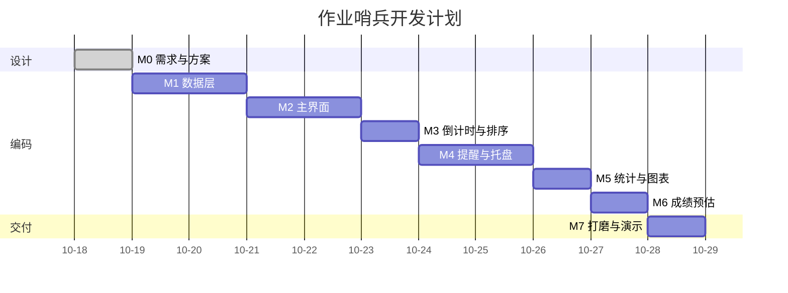

# 03 · 开发计划

| 项目 | 内容 |
| --- | --- |
| 文档版本 | v1.0 |
| 更新日期 | 2026-10-18 |
| 计划周期 | 2026-10-18 ~ 2026-10-27（约 7 个有效工作日） |
| 关联文档 | [02-技术方案](02-技术方案.md) · [04-测试与验收](04-测试与验收.md) |

---

## 1. 计划总览

### 1.1 节奏

```text
M0 方案（1 天） → M1 数据层（1.5 天） → M2 主界面（2 天） → M3 倒计时排序（1 天）
               → M4 提醒托盘（1.5 天） → M5 统计图表（1 天） → M6 成绩预估（1 天） → M7 打磨交付（1 天）
```

原则：**每个里程碑结束时必须是"可运行、可演示"的状态**，不做一次性大爆炸集成。

### 1.2 里程碑一览

| 里程碑 | 目标 | 关键产出 | 验收标准 | 预估 |
| --- | --- | --- | --- | --- |
| **M0** 需求与方案 ✅ | 想清楚再动手 | 目录重命名、Git 仓库、5 份文档、`.gitignore` | 文档齐全、公式自洽、评审通过 | 1 天（已完成） |
| **M1** 数据层 | 能存取数据 | `pom.xml`、模型、`schema.sql`、DAO、迁移器、单测 | `mvn test` 全绿；DAO 增删改查通过；中文无乱码 | 1.5 天 |
| **M2** 主界面 | 能看到和编辑作业 | 主窗口、表格、新建/编辑/删除对话框、课程筛选、状态切换 | 手工录入 10 条作业、重启后数据仍在 | 2 天 |
| **M3** 倒计时与排序 | 一眼看出轻重缓急 | 秒级刷新、颜色语义、紧急度算法、多列排序 | 5 条样例排序与人工判断一致；空闲 CPU 占用低 | 1 天 |
| **M4** 提醒与托盘 | 不漏交 | 调度器、分级提醒、去重、静音、托盘、单实例、启动补发 | 改系统时间模拟 24h/1h/15min 均准确触发且只一次 | 1.5 天 |
| **M5** 统计与图表 | 知道做到哪了 | 统计卡片、按课程完成度、JFreeChart 图表、权重完成度 | 数据变化 1 秒内刷新；图表无内存泄漏 | 1 天 |
| **M6** 成绩预估 | 算得清账 | 加权得分、总评预估、目标反推、GPA、课程成绩详情 | 3 个手算样例与程序一致（误差 < 0.01） | 1 天 |
| **M7** 打磨交付 | 能交、能讲 | 主题切换、异常兜底、示例数据、README 截图、fat jar、演示彩排 | 干净环境双击运行；5 分钟演示流畅 | 1 天 |

> 合计约 **9 人日**，含缓冲落在 10 天内。

### 1.3 时间表



> 如果 M2 超时，优先砍 M6 的 GPA 与 M5 的第二张图表（P1），保 P0 完整。

---

## 2. 任务分解（WBS）

### 2.1 M1 数据层（10-19 ~ 10-20）

| 编号 | 任务 | 产出 | 依赖 | 估时 |
| --- | --- | --- | --- | --- |
| T1.1 | 创建 Maven 工程与目录骨架 | `pom.xml`、`src/main/java`、`src/test/java`、`resources` | — | 1h |
| T1.2 | 实现 `AppPaths`、`ClockProvider`、`AppContext` | 三个核心类 + 手写装配 | T1.1 | 1.5h |
| T1.3 | 定义模型（4 个 record + 3 个枚举/接口） | `model/*` | T1.1 | 1.5h |
| T1.4 | 编写 `schema.sql` 与 `SchemaMigrator` | 建表、版本号、迁移框架 | T1.3 | 1.5h |
| T1.5 | 实现 `Database`（连接、PRAGMA、事务模板） | 单连接 + `inTransaction(Function)` | T1.4 | 1h |
| T1.6 | 实现 `CourseDao` / `AssignmentDao` / `ReminderLogDao` / `SettingDao` | CRUD + 条件查询 + 批量 | T1.5 | 3h |
| T1.7 | DAO 集成测试（内存/临时文件 SQLite） | 增删改查、级联删除、唯一约束 | T1.6 | 2h |
| T1.8 | 日志与全局异常处理 | `logging.properties`、`UncaughtExceptionHandler` | T1.1 | 1h |

**验收**：`mvn test` 绿；手工 `INSERT/SELECT` 能看到中文正常；删除课程级联删除作业。

### 2.2 M2 主界面（10-20 ~ 10-22）

| 编号 | 任务 | 产出 | 依赖 | 估时 |
| --- | --- | --- | --- | --- |
| T2.1 | 主窗口骨架 + FlatLaf 主题 + 菜单栏/工具栏 | `MainFrame`、`ThemeManager` | T1.2 | 2h |
| T2.2 | 作业表格模型与基础渲染 | `AssignmentTableModel`、列定义、行高 | T2.1 | 2h |
| T2.3 | 新建/编辑作业对话框（含课程下拉与快捷时间） | `AssignmentDialog` + 校验 | T2.2 | 3h |
| T2.4 | 删除、状态切换、右键菜单 | 交互闭环 | T2.3 | 1.5h |
| T2.5 | 课程列表与筛选、搜索框 | `CourseListPanel`、`TableRowSorter` 过滤器 | T2.2 | 2h |
| T2.6 | 课程管理对话框（增删改、学分） | `CourseDialog` | T2.5 | 1.5h |
| T2.7 | 空状态与引导（首次启动示例数据开关） | 首次启动向导/示例数据 | T2.3 | 1h |
| T2.8 | M2 手工走查 | 走查 checklist | 全部 | 1h |

**验收**：录入 10 条作业 → 关闭 → 重启 → 数据仍在；筛选、搜索、排序、编辑均正常。

### 2.3 M3 倒计时与排序（10-22 ~ 10-23）

| 编号 | 任务 | 产出 | 依赖 | 估时 |
| --- | --- | --- | --- | --- |
| T3.1 | `TimeUtils`：倒计时、逾期、格式化、日边界 | 纯函数 + 参数化单测 | T1.3 | 2h |
| T3.2 | `UrgencyCalculator`：评分与比较器 | 纯函数 + 单测（含 02 文档 5 条样例） | T3.1 | 2h |
| T3.3 | `CountdownRenderer`：徽章着色、等宽字体 | 自定义渲染器 | T3.2 | 1.5h |
| T3.4 | 秒级刷新 Timer（可见时运行、托盘时暂停） | 刷新机制 | T3.3 | 1h |
| T3.5 | 排序下拉（紧急度/截止/权重/课程）+ 表头排序联动 | `TableRowSorter` Comparator | T3.2 | 1.5h |
| T3.6 | 紧急度 tooltip（显示三个分量） | 可解释性 | T3.5 | 0.5h |

**验收**：样例数据排序结果与 02 文档示例表一致；改变系统时间界面 1 秒内更新。

### 2.4 M4 提醒与托盘（10-23 ~ 10-25）

| 编号 | 任务 | 产出 | 依赖 | 估时 |
| --- | --- | --- | --- | --- |
| T4.1 | `ReminderPlanner` 纯函数 + 单测（触发、去重、静音、补发） | 规划器 | T3.1 | 2.5h |
| T4.2 | `ReminderService`：调度线程、扫描、落库、合并摘要 | 服务 + 日志 | T4.1、T1.6 | 2.5h |
| T4.3 | `TrayController`：图标、菜单、气泡、点击定位 | 托盘 | T2.1 | 2h |
| T4.4 | 静音时段 + 恢复合并播报 | 设置项接入 | T4.2 | 1.5h |
| T4.5 | 单实例锁 `SingleInstanceGuard` | 文件锁 | T1.2 | 1h |
| T4.6 | 托盘不可用降级 + Toast 兜底 | 兼容 | T4.3 | 1h |
| T4.7 | 提醒测试钩子（菜单"测试提醒"、可调时间偏移） | 调试入口 | T4.2 | 1h |

**验收**：用"测试提醒"和系统时间调整，验证 T-24h/6h/1h/15m 各触发一次；重启不重复；静音期不弹窗、恢复后合并播报。

### 2.5 M5 统计与图表（10-25 ~ 10-26）

| 编号 | 任务 | 产出 | 依赖 | 估时 |
| --- | --- | --- | --- | --- |
| T5.1 | `StatisticsService`：完成率、权重完成度、按课程分组、剩余工作量 | 服务 + 单测 | T1.6 | 2h |
| T5.2 | 统计卡片（今日/本周/完成率/权重完成度/预计 GPA） | `DashboardPanel` | T5.1 | 1.5h |
| T5.3 | JFreeChart 柱状图（未来 14 天到期数量与权重） | `ChartPanelFactory` | T5.1 | 2h |
| T5.4 | 各课程完成度条形图 | 同上 | T5.1 | 1h |
| T5.5 | 图表数据刷新与主题配色适配 | 事件驱动刷新 | T5.3、T5.4 | 1h |
| T5.6 | 性能检查（1000 条数据滚动/刷新） | 压测记录 | 全部 | 1h |

**验收**：勾选/新增作业后统计 1 秒内更新；图表颜色与主题一致；连续切换主题 50 次无异常。

### 2.6 M6 成绩预估（10-26 ~ 10-27）

| 编号 | 任务 | 产出 | 依赖 | 估时 |
| --- | --- | --- | --- | --- |
| T6.1 | `GradeCalculator`：加权得分、总评、目标反推（BigDecimal） | 纯函数 + 参数化单测 | T1.3 | 2.5h |
| T6.2 | `GradeScale` 与默认 4.0 映射、GPA 计算 | 接口 + 实现 + 单测 | T6.1 | 1.5h |
| T6.3 | 课程成绩详情对话框（构成、预测、所需分） | `GradeDetailDialog` | T6.1 | 2h |
| T6.4 | 界面标注假设与边界（"仅录入 60% 权重"） | 文案与提示 | T6.3 | 1h |
| T6.5 | 与手算样例核对 | 核对记录 | 全部 | 0.5h |

**验收**：3 个课程样例（满权重/部分权重/无成绩）结果与手算一致；不可达场景提示正确。

### 2.7 M7 打磨与交付（10-27）

| 编号 | 任务 | 产出 | 依赖 | 估时 |
| --- | --- | --- | --- | --- |
| T7.1 | 深色主题切换与持久化 | `ThemeManager` 完善 | T5.5 | 1h |
| T7.2 | 全局异常兜底、启动自检（数据库可写、目录可创建） | 稳定性 | T4.6 | 1.5h |
| T7.3 | 示例数据（一键生成 12 门课/30 条作业） | Demo 数据 | T1.6 | 1h |
| T7.4 | 打包 fat jar + 干净环境验证 | `target/*.jar` | 全部 | 1h |
| T7.5 | README 截图、CHANGELOG、文档一致性校对 | 文档更新 | 全部 | 1.5h |
| T7.6 | 5 分钟演示彩排（见 04 文档 §7） | 演示脚本 | 全部 | 1h |
| T7.7 | 备份/恢复演练（复制 db） | 数据安全验证 | T7.4 | 0.5h |

**验收**：在只装了 JDK 17 的机器上 `java -jar` 直接运行；演示 5 分钟不卡壳。

---

## 3. 每日推进节奏

| 时段 | 内容 |
| --- | --- |
| 开始（15 min） | 跑 `mvn test` 确认基线绿；写下今天要完成的最小可交付 |
| 编码（2–3 h） | 按 WBS 顺序推进，先写纯函数与测试，再接 UI |
| 中途（15 min） | 跑一次程序，手工点一遍已完成功能，防止"最后才发现集成不上" |
| 收尾（30 min） | 提交代码、更新文档进度、记录明日待办与卡点 |

**每天必须能演示**：哪怕功能没做完，也要保证程序可启动、主流程可用。

---

## 4. 分支与提交规范

### 4.1 分支策略

独自开发，采用轻量策略：

```text
main                保持可运行；每个里程碑合并一次
 └─ feature/m1-data-layer
 └─ feature/m2-main-ui
 └─ feature/m4-reminders
 └─ fix/xxx           临时修复
```

- 开发在 feature 分支，`mvn test` 绿后合并回 `main`（`--no-ff` 保留历史）。
- 实验性改动（如换图表库）在独立分支，失败可丢弃。

### 4.2 提交信息（Conventional Commits）

```text
<type>(<scope>): <中文简述>

<可选正文：为什么这么改>

<可选脚注：关联任务 T1.6>
```

| type | 用途 |
| --- | --- |
| `feat` | 新功能 |
| `fix` | 修复缺陷 |
| `docs` | 文档 |
| `refactor` | 重构（不改行为） |
| `test` | 测试 |
| `build` | 构建/依赖 |
| `style` | 格式（不影响逻辑） |
| `chore` | 杂项 |

示例：

```text
feat(service): 实现紧急度评分与三级排序

权重 0.55/0.30/0.15，逾期额外加罚，完成项沉底。
对应 T3.2。

docs(design): 补充提醒去重与静音补发方案
fix(ui): 修复倒计时列在跨天后未刷新的问题
test(util): 补充闰年与跨年边界的参数化用例
```

**粒度**：一次提交只做一件事；能编译、能跑测试再提交。

---

## 5. 代码规范

| 项 | 约定 |
| --- | --- |
| 包名 | 全小写 `com.coursework.tracker.xxx` |
| 类名 | `UpperCamelCase`；模型用 `record`，服务用 `XxxService`，DAO 用 `XxxDao` |
| 方法/变量 | `lowerCamelCase`；布尔用 `is/has` 前缀 |
| 常量 | `UPPER_SNAKE_CASE`，集中在 `AppConfig` 或类内 |
| 注释 | public 类/方法写 Javadoc 摘要；复杂算法写"为什么"而不是"做什么" |
| 异常 | 业务异常 `BusinessException`；不吞异常；`catch` 必须记录或转换 |
| 日志 | `Logger.getLogger(ClassName.class.getName())`；INFO 记关键动作，WARNING 记可恢复异常，SEVERE 记崩溃 |
| 时间 | 禁止业务代码直接 `LocalDateTime.now()`，统一 `ClockProvider.now()` |
| 资源 | `try-with-resources`；`PreparedStatement` 必须参数化，禁止字符串拼接 SQL |
| 长度 | 单类 ≤ 400 行、单方法 ≤ 40 行；超过则拆分 |
| 编码 | 全项目 UTF-8（含源码、资源、文档） |

---

## 6. 质量门禁（DoD）

每个里程碑合并前必须全部满足：

- [ ] `mvn clean test` 通过，无失败、无跳过
- [ ] 新增核心算法有对应单元测试（覆盖率不低于上一里程碑）
- [ ] 程序可启动，主流程手工走查通过
- [ ] 无 `System.out.println` 调试残留（日志除外）
- [ ] 无未处理的关键 `TODO`（临时项标注 `TODO(P2)` 并登记）
- [ ] 中文显示正常，无乱码
- [ ] 提交信息符合规范，文档进度已更新
- [ ] 关闭程序后进程确实退出（无残留守护线程）

---

## 7. 交付物清单

| 类别 | 交付物 | 位置 | 状态 |
| --- | --- | --- | --- |
| 源码 | Maven 工程全部源码 | `src/` | 待完成 |
| 可执行包 | `coursework-tracker-1.0.0.jar` | `target/`（不提交仓库，答辩时随附） | 待完成 |
| 文档 | 需求分析、技术方案、开发计划、测试与验收、交付说明 | `docs/` | ✅ 已完成 |
| 说明 | `README.md`（含截图） | 根目录 | 待补截图 |
| 变更记录 | `CHANGELOG.md` | 根目录 | ✅ 已建立 |
| 演示 | 5 分钟演示脚本 + 示例数据 | `docs/04` §7、程序内"生成示例数据" | 待完成 |
| 数据库样例 | 含 12 门课 / 30 条作业的 `coursework.db` | `data/`（答辩用，不入库） | 待生成 |

---

## 8. 风险与缓冲

| 风险 | 触发信号 | 应对预案 |
| --- | --- | --- |
| 主界面耗时超预期 | M2 结束时对话框仍未完成 | 砍课程管理（FR-08 降级为只读），保作业 CRUD |
| 打包后 SQLite 加载失败 | `java -jar` 报 `UnsatisfiedLinkError` | 当天切换 `maven-assembly-plugin` 输出 `lib/`；仍失败则临时改 H2（DAO 已隔离） |
| 提醒调试困难 | 需要等几小时才能验证一次 | 提供"测试提醒"菜单与可配置时间偏移；用 `Clock.fixed` 写单测 |
| 图表卡顿 | 切换主题或刷新时界面停顿 | 降低刷新频率（数据变更才重算）、关闭动画、缩小数据集 |
| 时间不够 | 距离截止不足 3 天仍有 P0 未完成 | 冻结新功能，只修缺陷 + 补文档 + 录屏演示 |
| 答辩被问倒 | 讲不清算法 | 准备 02 文档 §5 的公式与示例，提前演练 3 遍 |

**缓冲**：总估时 9 人日，窗口 10 天，留 1 天机动；M7 当天不排新功能。

---

## 9. 进度追踪方式

用本项目自己管理本项目（吃自己的狗粮）：

1. 在程序里建 12 门课，把 M1–M7 的任务当作"作业"录入，权重按重要性设置；
2. 每天开工看紧急度排序，完成后勾选；
3. 用程序的完成度与图表复盘进度；
4. 发现工具不好用的地方，立刻记进 `docs/` 的"体验问题"清单，作为 P1 改进输入。

> 这既是项目管理，也是最真实的产品验证：如果自己都不愿意每天打开它，说明设计有问题。
